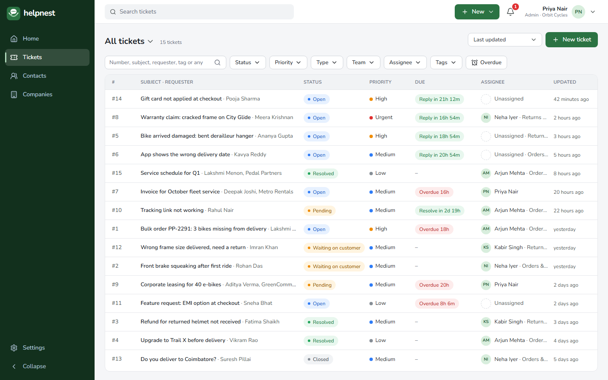
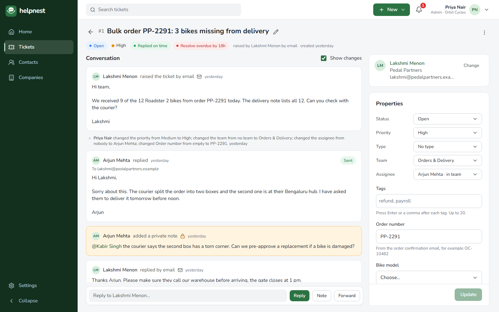
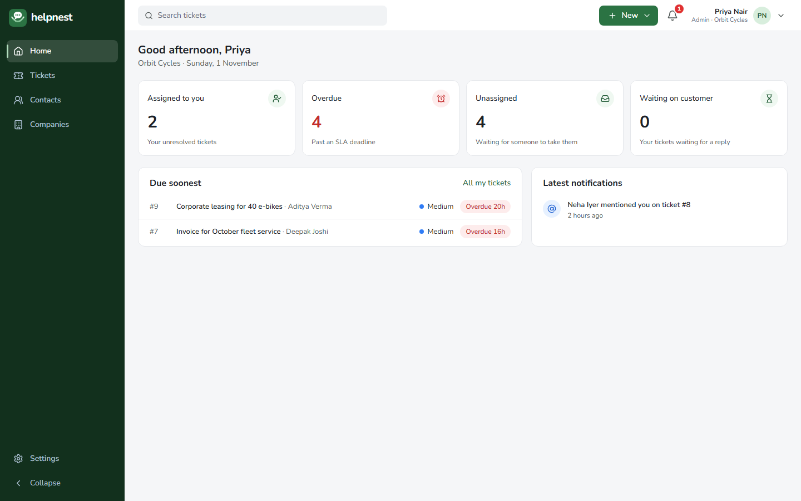
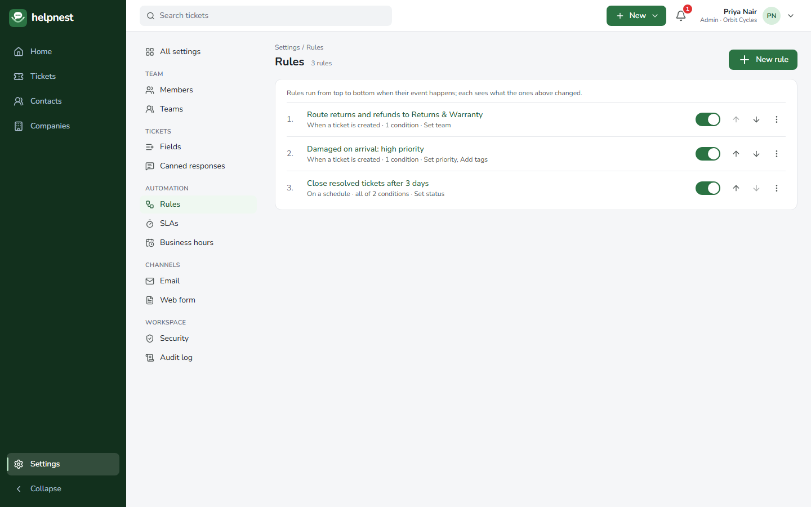
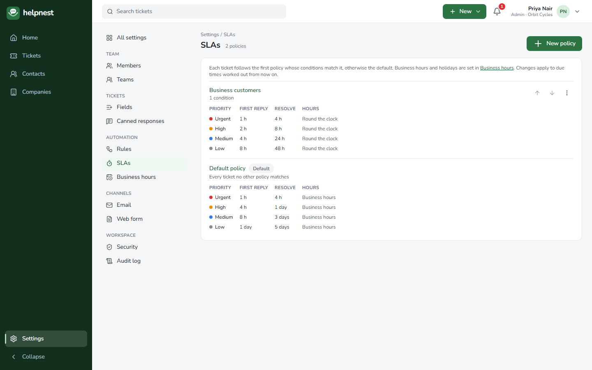
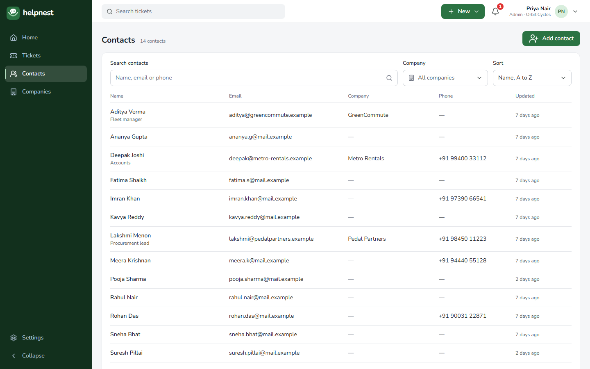
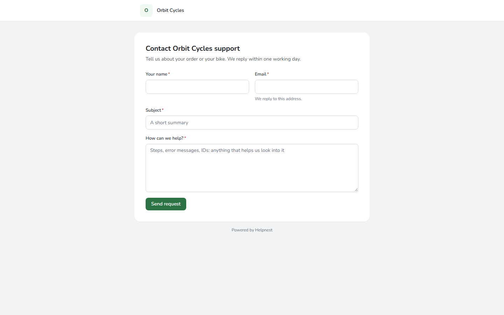
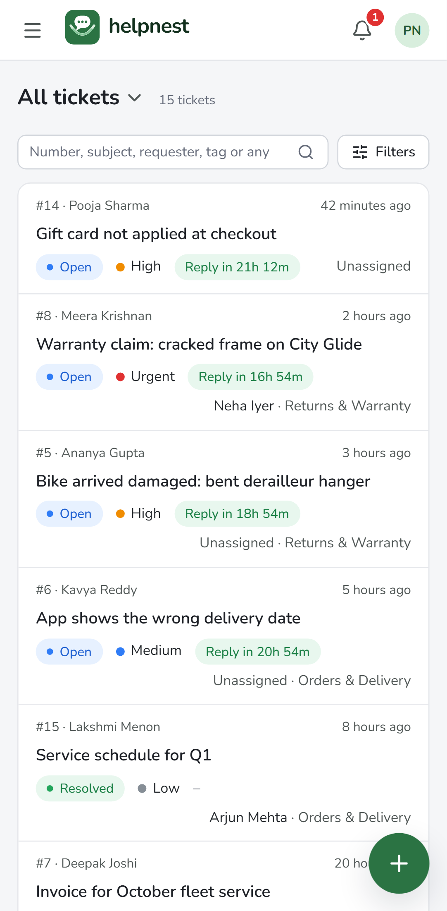
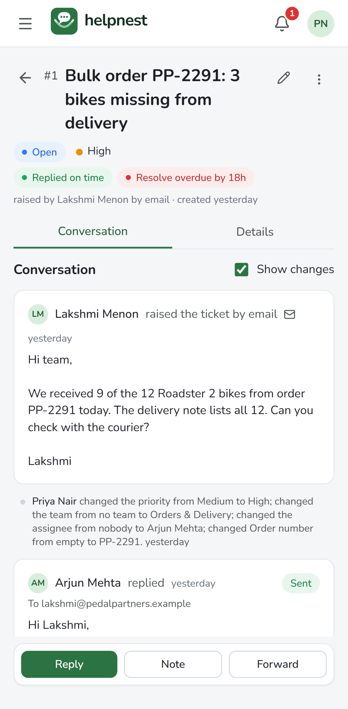
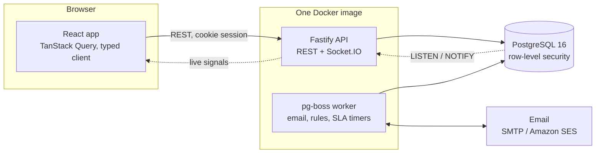

# helpdesk-web

Frontend for Helpnest, a multi-tenant SaaS help desk. The product name is set in `src/product.ts` (rename steps: helpdesk-api `docs/BRANDING.md`). React + Vite + TypeScript.

## About the project

Helpnest is a multi-tenant help desk: support teams turn customer emails and web-form requests into tickets, work them together in real time, and automate routing and deadlines. I built it end to end as a portfolio project: product, frontend, backend, database, tests and infrastructure.

**Live demo:** DEMO_LINK, no sign-up needed. It runs in your browser with sample data from a fictional bicycle shop's support team; try replying, assigning, filtering and changing settings (changes reset when you reload). A guided walkthrough is in [docs/demo-video-script.md](docs/demo-video-script.md).

| Frontend                                                                    | Backend                                                                     |
| --------------------------------------------------------------------------- | --------------------------------------------------------------------------- |
| [hariprasath14/Helpdesk-Web](https://github.com/hariprasath14/Helpdesk-Web) | [hariprasath14/Helpdesk-API](https://github.com/hariprasath14/Helpdesk-API) |




<details>
<summary>More screenshots: home, rules, SLAs, contacts, phone, web form</summary>















</details>

### What it does

- **Tickets from everywhere:** customer emails become tickets (replies thread onto the same ticket), plus a public web form and tickets agents log themselves.
- **Teamwork:** assignment, private notes with @mentions, saved views, canned responses with placeholders, merge and split, a notification center.
- **Real time:** lists, tickets and notifications update live; agents see who else is on a ticket before replying.
- **Automation:** a rules engine for new tickets, updates, customer replies and schedules (routing, round-robin, tags, emails), SLA policies with business hours and holidays, warnings and escalation.
- **Workspaces:** each company gets its own address (`acme.<domain>`), roles and permissions, teams, custom fields, two-step sign-in and an audit log.

### Architecture



### Engineering highlights

- **Tenant isolation in the database:** every query runs with the workspace set on the connection, and PostgreSQL row-level security filters every workspace table by it, so a forgotten filter in code still cannot leak another company's data. Separate writer, reader and migration roles with least privilege.
- **API-first and type-safe end to end:** Zod schemas on each route generate the OpenAPI contract, which generates the frontend's typed client and form validation; a contract change that breaks the frontend fails its type check.
- **Reliable background work:** email in and out, rules, SLA clocks and notifications run as background jobs with retries on PostgreSQL (pg-boss), with no extra infrastructure.
- **Security:** Argon2 password hashing, breached-password check, TOTP two-step sign-in with recovery codes, CSRF protection, rate limits, sanitized email HTML, an audit log of sensitive actions.
- **Tested like a product:** about 880 unit and integration tests with coverage minimums (statements above 90%), and 24 Playwright end-to-end suites against the real API, worker and mail server, with accessibility checks (axe, WCAG 2.1 AA) at desktop and phone widths.
- **One codebase, any environment:** settings come from validated environment variables; email, storage and payments go through adapters chosen by settings; AWS infrastructure (ECS Fargate, CDK) is written as code.
- **The demo is the real frontend:** a seed script builds the sample workspace through the real API and saves what every screen reads; in the demo build, a service worker answers the app's API calls from that data, and a test checks it against the API contract.

**Stack:** TypeScript · React 19 · Vite · TanStack Query · Tailwind CSS · Fastify · Socket.IO · PostgreSQL · Sequelize · pg-boss · Zod + OpenAPI · Vitest · Playwright · Docker · AWS CDK

## Developer guide

The backend lives in the separate `helpdesk-api` repository. The overall architecture is in `helpdesk-api/docs/ARCHITECTURE.md`; coding rules in `helpdesk-api/docs/ENGINEERING_STANDARDS.md`.

## Tech stack

TypeScript · React 19 · Vite · React Router · TanStack Query · orval (API client from OpenAPI) · Tailwind CSS 4 · Radix UI primitives · Lucide icons · Nunito · Vitest + Testing Library + MSW · Playwright + axe

## Run locally

Prerequisites: Node.js 24 (LTS; `nvm use 24`), and `helpdesk-api` running locally with its Docker services (`docker compose up -d` and `npm run dev` in that repo; see its README).

```bash
nvm use                     # picks Node 24 from .nvmrc
cp .env.example .env        # local defaults work as they are
npm install                 # also installs the Git hooks
npm run dev                 # http://localhost:5173
```

| Address                             | What opens                                                                    |
| ----------------------------------- | ----------------------------------------------------------------------------- |
| http://localhost:5173               | Main address: sign-up (`/signup`), Terms, Privacy, design preview (`/design`) |
| `http://<workspace>.localhost:5173` | A workspace, for example `acme.localhost:5173`                                |
| http://localhost:8025               | Mailpit, where sign-up emails arrive locally                                  |

Browsers resolve `*.localhost` to your own machine, so workspace addresses need no hosts-file changes. The dev server forwards `/api`, `/health` and `/docs` to the API (`API_PROXY_TARGET`), so the app always calls the API on its own address, as it does on AWS.

### Scripts

| Script                            | Does                                                                                |
| --------------------------------- | ----------------------------------------------------------------------------------- |
| `npm run dev`                     | Start the dev server on port 5173 (fails rather than moving to another port)        |
| `npm run build`                   | Type check, then production build into `dist/`                                      |
| `npm run preview`                 | Serve the production build locally                                                  |
| `npm run api:generate`            | Regenerate `src/api/generated` from `../helpdesk-api/openapi.json`                  |
| `npm run typecheck`               | TypeScript check (fails if the API contract changed and the client was regenerated) |
| `npm test`                        | Unit and component tests (Vitest, mocked API); `test:watch`, `test:coverage`        |
| `npm run test:e2e`                | End-to-end tests in a real browser against the real API (Playwright)                |
| `npm run lint` / `lint:fix`       | ESLint: TypeScript strict, React hooks, accessibility and security rules            |
| `npm run format` / `format:check` | Prettier                                                                            |
| `npm run audit`                   | Fail on high or critical vulnerabilities in production dependencies                 |
| `npm run check`                   | Format, lint, types, tests with coverage minimums, audit (the pipeline runs this)   |
| `npm run dev:demo`                | The demo (no API needed) on the dev server: see "Demo build"                        |
| `npm run build:demo`              | Type check, then the demo build into `dist/`                                        |
| `npm run demo:snapshot`           | Rebuild the demo's sample data from the real local API (API and worker running)     |

First time running end-to-end tests: `npx playwright install chromium` downloads the test browser.

### Git hooks

Installed automatically by `npm install` (Husky): **pre-commit** fixes staged files with ESLint and Prettier, then type checks; **commit-msg** requires Conventional Commits (`feat: …`, `fix: …`).

## Folder structure

```
src/
├── main.tsx       mounts the app
├── config.ts      build settings (VITE_*), checked at startup
├── brands.ts      the brand packs (Forest, Indigo): names, logos, address-bar colour
├── app/           App providers, routes (main address vs workspace), host.ts (which address
│                  this is), query client, MainLayout (loads the session), shell-config.ts
│   └── shell/     the app shell: AppShell, Sidebar, TopBar, MobileNav, NavLinks
├── features/      one folder per feature: pages, components, hooks, tests
│                  (auth/: sign-up, check email, confirm email, Terms and Privacy;
│                  login, forgot and reset password, find your workspace; account/: your
│                  account page; two-factor/: setup, recovery codes, the required-setup
│                  screen; members/: members page, invite drawer, accept page, password
│                  confirmation; audit/: Settings → Audit log; custom-fields/: Settings →
│                  Fields, CustomFieldInput and the record forms' custom field
│                  editor and list; contacts/: contacts and companies (lists, pages,
│                  drawers, company picker); settings/: the Settings
│                  area and Security; workspace/:
│                  signed-in pages; system/; design-preview/)
├── components/    shared design-system components: Button, Badge, Avatar, StateMessage (empty,
│                  error, no access), Skeleton, Toast, ConfirmDialog, Drawer, Menu, Tooltip,
│                  PageHeader, Logo, TextField, PasswordField, CheckboxField, SwitchField,
│                  SelectField
├── api/
│   ├── http.ts    fetch wrapper behind every API call, ApiError
│   └── generated/ typed client, models and zod/ schemas from the backend's OpenAPI spec
│                  (don't edit by hand)
├── assets/brands/ one folder per brand: mark.svg (the nest logo mark)
├── demo/          the demo build's stand-in API: snapshot.json (sample data from the real API),
│                  data.ts (dates moved to now), store.ts (ticket rules), handlers.ts (MSW)
├── lib/           helpers: cn (class names), initials, password strength, workspace address,
│                  debounced value, goTo (full-page navigation); Socket.IO client later
├── styles/        tokens.css (all colours), fonts.css, global.css (Tailwind setup)
└── test/          test setup: mocked API (MSW), render helper
e2e/               Playwright end-to-end tests and the accessibility check; demo/ builds the demo's
                   sample data (not part of the suite)
docs/screenshots/  the README's screenshots, taken from the demo
docs/demo-video-script.md  the demo's video script and interview walkthrough
public/brands/     one folder per brand: favicon.svg (the mark), apple-touch-icon.png (180px)
deploy/dev-lightsail/  TEMPORARY dev server (no budget yet): deploy.sh
```

## Frontend flows

### App start

1. `config.ts` checks the build settings; an invalid `VITE_API_URL` or `VITE_APP_DOMAIN` stops the app with a clear message.
2. `hostKind()` (`src/app/host.ts`) reads the address: the main address (`VITE_APP_DOMAIN`, for example `localhost`) or a workspace (`acme.localhost`). Each has its own routes.
3. `App` sets up the server-data cache (TanStack Query) and the router.
4. **Main address:** sign-up, check email, Terms, Privacy (and the design preview when enabled); `/` goes to `/signup`.
5. **Workspace address:** `/login`, `/forgot-password`, `/reset-password` and `/verify-email` work signed out. Every other page loads `GET /api/v1/me` in `MainLayout`: signed in → the app shell; `401` → the login page with `?next=` (back to that page afterwards); `404` → "Workspace not found" with a link to create one; network or server error → a retry message.
6. **Session ends while open** (idle timeout, signed out elsewhere, password changed): any request answered `401 UNAUTHORIZED` makes the query client check `/me` again, and `MainLayout` sends the person to `/login?next=…&reason=expired` ("Your session ended. Sign in again to continue.").
7. **Two-step verification required:** when `/me` says `twoFactor.setupRequired`, `MainLayout` shows only the setup screen (and Sign out) until it is done. With 2 or fewer recovery codes left, a banner above every page links to Your account.
8. Unknown addresses show a "Page not found" page; a crashing page shows "Something went wrong" instead of a blank screen, without exposing the error.

Planned: the Socket.IO connection after sign-in (Step 5).

### API client

The backend's contract is `helpdesk-api/openapi.json`. `npm run api:generate` (orval) turns it into typed functions and React Query hooks in `src/api/generated`: reads become queries (`useGetApiV1Me()`), and POST, PUT, PATCH and DELETE become mutations (`usePostApiV1Signup()`), so a create only runs when the user acts. It also writes Zod schemas to `src/api/generated/zod`; forms check input with them before sending, and show our own wording. The generated code is committed; pipelines build it and never regenerate.

When the backend changes: pull `helpdesk-api`'s `dev-deploy` (the version that will be deployed), run `npm run api:generate`, fix any type errors, and commit. The backend always deploys first and never breaks `/api/v1` (see ENGINEERING_STANDARDS.md, "API changes and deployment order").

Every call goes through `apiFetch` in `src/api/http.ts`:

- calls the API on the app's own address (`/api/...`), or on `VITE_API_URL` when set, and sends the session cookie;
- sends the session's CSRF token in `X-CSRF-Token` on every POST, PUT, PATCH and DELETE. The token comes with `/me`, login and password change; the query client keeps it in step with the cached session (`setCsrfToken`);
- returns the response body directly;
- turns every failure into one `ApiError` with `status`, `code`, a user-safe `message` and `details` (for example invalid fields). Status `0` means the API could not be reached.

### Data fetching

- Screens read server data through the generated hooks; TanStack Query caches it, refreshes it when the window regains focus, and shares it between screens.
- Network and server errors are retried twice; client errors (4xx) are not. Mutations are never retried, so a create is never sent twice.
- Live Socket.IO events will update or refresh the cache (Step 5).

### App shell

Every signed-in page renders inside `AppShell` (Figma "App shell"):

- **Desktop:** dark sidebar in the brand's darkest shade (brand 900: dark green for Forest) on the left (icons and labels; collapses to icons with tooltips, and the choice is remembered on the device), white top bar, light grey page area with 24px gutters, and a "Skip to content" link for keyboard users.
- **Tablet (768–1023px, Step 5b):** the sidebar starts as icons to leave room for the page; expanding it lasts for the visit (from 1024px the collapsed choice is remembered).
- **Phone (under 768px):** a menu button opens the sidebar as a slide-in panel; "New" becomes a floating round button, and the page area keeps room under its last line so the button never covers it.
- **One frame, scrolling inside (Step 5b):** the shell fills the window; only the page area (and panels such as drawers) scroll, with thin 6px scrollbars everywhere (`styles/global.css`, tokens `--scrollbar` and `--scrollbar-hover`).
- **Page header:** the page's actions stay on the title's row at every width; on phones the title wraps beside them and the grey meta drops below (`components/PageHeader.tsx`).
- **What it shows comes from `src/app/shell-config.ts`.** Each part appears only when a feature provides it, so the app never shows a button that does nothing yet: search (F10), trial pill and Upgrade (F30), the New menu (Ticket, Contact, Company; Contact and Company open their Add drawer over the current page), notifications (F25) and help. Today the workspace shell has Home, Settings at the bottom of the sidebar for admins and supervisors (its own menu: Members, Security, filtered by permission), and the user menu with Your account, Find your other workspaces and Sign out; the design preview lives on the main address at `/design`.

### Design system

- **Colours** live only in `src/styles/tokens.css`, mirroring the Figma variable collections. Components use semantic Tailwind classes such as `bg-brand-button`, `text-ink-muted` and `bg-danger-bg`; Tailwind's default palette is switched off, so raw colours cannot creep in.
- **Brand packs:** Helpnest has two themes, Forest (default) and Indigo. `VITE_BRAND` sets the deployment's default; each person can pick the other in Your account → Appearance (saved on the server, applied by `MainLayout`). A brand pack is:

  | Part                                          | Where                                                  |
  | --------------------------------------------- | ------------------------------------------------------ |
  | Palette, shades 50 to 900                     | `src/styles/tokens.css`, a `[data-brand='<id>']` block |
  | Logo mark                                     | `src/assets/brands/<id>/mark.svg`                      |
  | Browser tab icon, phone home-screen icon      | `public/brands/<id>/`                                  |
  | Name and phone address-bar colour (brand 900) | `src/brands.ts`                                        |

  **Changes with the brand:** the palette and every role built from it (buttons 600, links 700, tints 50 and 100, focus ring 500, the sidebar 900 and its active marker 200), the logo mark, the wordmark ink (brand 900, the `wordmark` token), the icons and the address-bar colour. **Same in every brand:** neutrals and text colours, status, SLA, priority and feedback colours, the accent orange, Nunito, spacing, radius, shadows and all components.

  At startup `BrandProvider` applies the brand: `data-brand` on `<html>` (which switches every colour token), the favicon, the home-screen icon and the address-bar colour. Components that need brand files (the logo) read the active brand with `useBrand()`. `index.html` starts with Forest, so the first paint is right for the default.

  **Adding a brand:** add a palette block in `tokens.css`, a logo folder, an icon folder, an entry in `brands.ts`, and the id in the API's `THEMES` (with a migration); check every text and background pair passes WCAG AA; the brand test checks the pack is complete.

  This is Helpnest's own look. Customer branding (F32: a workspace's own logo on emails and the web form) is separate.

- **Sidebar:** brand 900 background; the active item is white at 14% opacity with white text and icon and a 3px brand 200 marker on the left; hover is white at 8%. Status, SLA, priority and feedback colours never change with the brand.
- **Contrast:** every text and background pair passes WCAG AA (4.5:1); `tokens.css` notes the close ones. Buttons use brand 600; links and small brand-coloured text use brand 700.
- **Font:** Nunito, from the npm package `@fontsource-variable/nunito` (one variable file for all weights, imported in `src/styles/fonts.css`; SIL Open Font License).
- **Accessibility built in:** dialogs, drawers, menus, toasts and tooltips use Radix UI primitives (focus handling, keyboard support, screen-reader roles) styled with our tokens. Icon-only buttons require a label. Focus is always visible. Animations respect "reduce motion".
- **Shared states:** loading (`TableSkeleton`), empty (`EmptyState`), error with retry and support code (`ErrorState`), no access (`NoAccessState`), toasts bottom right (top centre on phones, clear of the New button) for 5 seconds with at most one action, confirm dialog that starts on Cancel and names the action, right-side drawer with a sticky footer.
- **Never lose unsaved changes (Step 5b):** `UnsavedChangesGuard` asks "Leave without saving?" when someone leaves a page with unsaved edits (the browser's own prompt for reloading or closing the tab); pages render it only while they have changes (ticket properties, business hours, email sender name, web form text, your name). A `Drawer` that has been typed in asks "Discard your changes?" before closing with X, Escape or a click outside, and before the browser's Back; its own Cancel discards without asking, and saving is never blocked. `TextField` and `SelectField` take `hideLabel` for table cells (the label stays for screen readers).
- **Class names:** `cn()` joins classes and lets a later class override a conflicting one (`tailwind-merge`).
- **Logo:** `Logo` shows the active brand's mark (an SVG per brand in `src/assets/brands/<id>/mark.svg`, the Figma components Logo/Mark and Logo/Mark · Indigo: a white chat bubble resting in a nest on a tile in the brand's 600 shade) and, beside it, the product name from `src/product.ts` as the wordmark: live text in Nunito ExtraBold, white on the dark sidebar and brand 900 (the `wordmark` token) on white. The collapsed sidebar shows the mark alone. Renaming the product renames the logo; there is no wordmark image to redraw. The mark loads as an image, so its internal ids never clash with other SVGs; its colours are its own.

**Design preview** (`VITE_DESIGN_PREVIEW=true`, local and dev): `/design` shows every token, component and state with a brand switch; `/design/shell` shows the full shell with sample data and a switch between the content, loading, empty, error and no-access states.

### Permissions in the UI

Actions the user's role can't perform are hidden. The API still enforces every permission.

### Feature flows

Added here as each feature is built (login and 2FA, ticket list, ticket detail and reply, assignment, SLA indicators, rules, settings, billing).

#### Sign-up and workspace (F1)

1. **Sign-up** (`/signup`, main address): full name, work email, password, company name, workspace address, and agreement to the Terms and Privacy Policy.
   - The workspace address is suggested from the company name until the person edits it, cleaned as they type, and checked live (400 ms after typing stops): available, taken, reserved or invalid. Taken or reserved addresses come with clickable alternatives.
   - Any real email works, including Gmail; throwaway email services (Mailinator and similar) are refused, with the reason under the email field.
   - Password: at least 12 characters, a strength bar, and show/hide. The server also refuses passwords found in data breaches.
   - The browser's timezone is sent with the form.
   - Errors appear under each field and focus moves to the first one. Server field errors (breached password, address taken at the last moment) appear the same way; too many attempts shows a plain message.
2. **Check your email** (`/signup/check-email`): shows the address the link went to and a Resend button with a 60-second countdown. Opened without an email, it goes back to sign-up.
3. **Confirm email** (`/verify-email?token=…` on the new workspace address, from the email): confirms once, signs the owner in, and opens the workspace.
   - Expired link: "Send a new link" goes to the main address and sends a fresh one automatically.
   - Used link: a link to the workspace. Invalid or missing link: a link to sign-up. Network error: Try again.
4. **Welcome** (`/` in the workspace): "Welcome to {workspace}, {first name}" with a Get started checklist; items arrive with later features and show "Coming soon".

The server answers the same way whether or not an email is already registered (an existing person gets an "already have an account" email instead), so the form never reveals who has an account. 5. **Step 5b layout (`AuthLayout`, every sign-up, sign-in, password, two-step, invitation and email page):** from 1024px the form on a white column and, beside it, a panel in the brand's sidebar colour saying what Helpnest does (three points and a few sample tickets with their deadlines; decorative, not real data). Narrower, the logo and a white card as before.

#### Login and password (F2)

1. **Login** (`/login` on the workspace address): email and password (show/hide, Caps Lock warning), "Forgot password?", and "Find your workspace" for the wrong address.
   - Wrong email, wrong password and "not a member here" all show "Email or password is incorrect."; the password is cleared and focused.
   - After 5 failures in 15 minutes the server locks that email for 15 minutes and the page shows its message.
   - Already signed in → straight in. Afterwards → the `?next=` page (only paths in this app; anything else goes to `/`).
   - `?reason=` shows why the person is here: `signed-out`, `password-reset` or `expired`.
2. **Find your workspace** (`/login` on the main address): type a workspace address to go to its login page, or enter an email to get links to every workspace it belongs to (same answer for any email). Linked from sign-up ("Already have an account? Sign in").
3. **Forgot password** (`/forgot-password`): email → "Check your email" (same answer for any email). The link expires in 1 hour.
4. **Reset password** (`/reset-password?token=…` from the email): the link is checked first (expired, used and invalid each explain themselves and offer "Get a new link"); then the new password (strength bar, not one of the last 5). Saving signs the person out everywhere and opens the login page with "Your password was changed".
5. **Your account** (`/account`, from the user menu; Step 5b: tabs **Profile**, **Security** (`?tab=security`: password, two-step verification, other devices), **Notifications** (`?tab=notifications`) and **Appearance** (`?tab=appearance`), kept in the address): change your name; change your password (current + new; other devices are signed out and this browser gets a fresh session); "Sign out of all other devices".
6. **Sign out** (user menu): ends the session on the server, then loads `/login?reason=signed-out` afresh, so nothing from the session stays in memory.

#### Two-step verification (F3)

1. **Turn on** (Your account → Two-step verification → Turn on): confirm your password; scan the QR code or type the setup key (grouped in fours); enter the first 6-digit code; save the 10 recovery codes (Copy, Download, Print) and tick "I've saved these codes" before Done.
2. **Login code step:** after the password, "Two-step verification" asks for the 6-digit code (sent as soon as 6 digits are typed), or a recovery code ("Use a recovery code instead"), with "Don't ask again on this device for 30 days". A wrong code is cleared and explained; a timed-out challenge or a lock goes back to the password step with the reason.
3. **Manage** (Your account, when on): recovery codes left, "New recovery codes" (password, then the new codes), "Turn off" (password plus a code or recovery code). Turn off is disabled while this workspace requires it, and another workspace's rule is explained if the server refuses.
4. **Required by the workspace:** the setup screen replaces the app until it is done.
5. **Settings → Security** (admins; other roles see "no access"): the "Require two-step verification for everyone" switch with how many members have it on. It stays disabled until the admin has it on themselves.

#### Agents and roles (F4)

1. **Permissions in the UI:** `/me` carries `permissions`; `can(me, 'members.manage')` (from `features/workspace/session-context.ts`) decides what to show. The API enforces the same rules.
2. **Settings** (sidebar): `/settings` is an overview of the settings pages a role can use, in groups (Team, Tickets, Automation, Channels, Workspace) with an icon and one line each (`features/settings/settings-pages.ts`). From 1024px a grouped menu with the same icons sits beside every settings page; narrower, the overview is the menu and each page starts with "All settings" to go back. Agents see only Canned responses.
3. **Members** (`/settings/members`): everyone with role, Owner, two-step On/Off and last active (or Deactivated), with search and a role filter; open invitations with role, inviter and expiry. Supervisors see it read-only.
4. **Admin actions:** "Invite people" (a drawer: emails separated by commas or new lines, up to 20, and a role with its description; skipped people are listed with the reason); per member "Make Admin/Supervisor/Agent", "Reset two-step verification" (when on) and "Deactivate", both confirmed first, or "Reactivate"; per invitation Resend and Revoke. No actions on the owner or yourself.
5. **Confirm your password:** when the API answers `REAUTH_REQUIRED`, a dialog asks for the password and then repeats the action (`useReauth()` in `features/members/use-reauth.tsx`).
6. **Accepting an invitation** (`/invite?token=…`, workspace address): the link is checked first (expired, used and invalid explain themselves); someone new enters a name and a password, someone with a Helpnest account their password (and code when needed); then the workspace opens.

#### Audit log (F5)

**Settings → Audit log** (`/settings/audit-log`, admins): entries newest first with the time in the workspace's time zone (exact UTC on hover), a plain sentence, who (email and role), IP and device, and a category badge. Filters: period (24 hours, 7, 30 or 90 days, custom dates in the workspace's time zone, or all time), person, category and search; "Load more" pages with the API's cursor. "Export CSV" downloads the same filters (a plain link: the browser sends the session cookie).

#### Custom fields (F6)

1. **Settings → Fields** (`/settings/fields`, admins; others see "no access"): tabs for Tickets, Contacts and Companies (`?for=contact`); the record type's standard fields first, locked and marked "Standard" (`standardFields` from the API, the same definition the API enforces; tickets add theirs with F9), so admins see the whole form; then the custom fields: active fields in form order with type, internal name and rule ("Required", "Required when resolving"); "Add field" (disabled at 50); archived fields below with Restore.
2. **Add or edit** (a drawer): label, type (locked after adding, with the reason), help text, choices (Enter adds the next one; move up or down; one default for a dropdown, any for a multi-select; removed choices listed with "Bring back"), "Ticked by default" for checkboxes, and the required rule ("When resolving" on tickets only). A live preview shows the field as agents will see it. Editing sends only what changed, so the audit log names real changes; nothing changed just closes.
3. **Order:** drag a row by its handle (mouse), or "Move up" / "Move down" in the row's menu (keyboard and touch). Saved at once; if someone else changed the list meanwhile, the page says so and reloads it.
4. **Archive** (asked first): hidden from forms, values kept; Restore puts it back at the end.
5. **`CustomFieldInput`** (`features/custom-fields/CustomFieldInput.tsx`) draws one field for its type; the ticket, contact and company forms (F7, F9) use it. Number boxes keep what is typed ("1.") and pass numbers up; removed choices show only when the record already has them.
6. **Step 5b layout:** your fields first ("Your fields"), the built-in ones folded away below under **Standard fields** (click to open).

#### Contacts and companies (F7)

1. **Contacts** (sidebar, every member): name and job title, email, company, phone and last update; search (name, email or phone), a company filter (the company picker) and sort (name or recently updated); the count in the header; "Load more" pages with the API's cursor.
2. **Add or edit a contact** (a drawer): name, email, phone, up to 5 other emails, job title, company (left empty on a new contact, the API matches it by the email's domain; choosing "No company" turns that off), a note and the contact custom fields (`CustomFieldsEditor`, starting at their defaults; archived ones with a value shown but locked). Editing sends only what changed. API messages show next to their fields, including `otherEmails.1` and `customFields.<key>`.
3. **Contact page** (`/contacts/:id`; Step 5b: their tickets first and wide, the details beside them from 1024px, an avatar by the name): details (mailto and tel links, other emails, company link, note) and custom fields (`CustomFieldsList`), and their latest tickets (F9) with "New ticket". Admins and supervisors get "Delete contact" (asked first).
4. **Companies** (sidebar): name, domains and contact count, with search and "Load more". **Company page** (Step 5b: tickets and contacts in the wide column, details beside them): details (domains, phone, website link, note, custom fields), its contacts with search, sort and "Add contact" (the company is pre-chosen), Edit, and Delete for admins and supervisors (the dialog says how many contacts stay, without a company).
5. **Add or edit a company** (a drawer): name, email domains (one per box; free email services are refused by the API), phone, website, note and company custom fields.
6. **Caches:** any contact or company change marks every contact and company query stale (`refreshDirectory()`), because counts and names show on both sides.

#### Teams (F8)

1. **Settings → Teams** (`/settings/teams`, admins and supervisors; supervisors read-only, agents "no access"): each team with its description, people (avatars and count) and leads; "New team"; an empty state that explains what teams are for.
2. **Add or edit a team** (a drawer, `TeamDrawer`): name, description, and people: "Add people" opens a search of active members (several can be added in a row), each person has a "Lead" box and a remove button, and deactivated people already in the team are marked. Saving sends the version loaded (`updatedAt`); when someone else changed the team meanwhile, the drawer says so and the list reloads.
3. **Delete** from the team's menu, asked first (the dialog says how many people stay in the workspace).
4. **Members page:** a Teams column (two chips, then "+N"; "· Lead" on leads), a team filter (including "No team"), and open invitations show the teams the person will join. The deactivate dialog says they keep their teams but get no new tickets.
5. **Invite people:** when the workspace has teams, the drawer lists them as checkboxes; the invited person joins them on accepting.

#### Tickets (F9)

1. **Tickets** (sidebar, every member; `/tickets`): number, subject and tags, requester and company, status and priority badges, team and last update, most recently updated first, with "Load more". Admins get **Trash** (`?view=trash`). Views, filters, search and order: F10.
2. **New ticket** (`/tickets/new`; also **New → Ticket**, and "New ticket" on a contact's page, which starts with that contact): requester (`RequesterPicker`: search contacts, or "New contact" with a name and an email or phone; an email typed in the search fills it in), subject, description, status, priority, type, team, tags (`TagInput`: Enter or a comma adds one; tags in use are suggested) and the ticket custom fields with their defaults. Opens the new ticket.
3. **Ticket page** (`/tickets/:number`): the subject (pencil to rename; long subjects wrap), status and priority badges, who raised it and when; the conversation (F11), with the history's changes in between (one sentence each, from `ticket-history.ts`, for example "Asha Rao changed the status from Open to Pending; added tags refund."); the **Requester** card with links to the contact and company and "Change requester"; and **Properties** (`TicketFields`): **Update** sends only what changed, and "required when resolving" fields turn required when the status is Resolved or Closed. Admins delete from the ⋮ menu (to the trash); a trashed ticket shows a banner with **Restore ticket** and read-only properties. Unknown numbers show "This ticket doesn't exist".
4. **Ticket page layout (Step 5b):** one header band (back to tickets, the number, the subject with its pencil, Take it and More actions; then status, priority, SLA chips, who raised it, and who else is here); from 1024px the conversation and the details scroll separately, with the **reply bar** under the conversation and the properties' **Update** bar pinned at the bottom. The reply bar ("Reply to Neha Iyer…", Reply, Note, Forward) opens the composer on that tab; closing it keeps the drafts, and leaving the page with a draft asks first. The **requester card** shows the contact, company and email, Change (the requester picker), and their other open tickets. **Properties** are compact rows (label beside the value). Narrower than 1024px, **Conversation** and **Details** are tabs, and the reply bar stays at the bottom of the screen (no floating New button on a ticket).
5. **New ticket layout (Step 5b):** what the ticket is about on the left, its properties (compact rows) on the right from 1024px, Cancel and Create ticket pinned at the bottom; leaving after typing asks first.
6. **Contact and company pages** list their latest tickets (`RelatedTickets`, Step 5b): a compact table (number, subject, status or "Merged into #N", priority, assignee, updated) when its box is wide enough, two lines per ticket when it is not (a container query, so it fits any column).
7. **Caches:** a ticket change marks every ticket query stale (`refreshTickets()`); the saved ticket goes straight into the cache, so the page does not wait for a reload.

#### Ticket list (F10)

1. **Views** (the page title opens them at every screen size, Step 5b): built-in views (All unresolved, where the list starts; My unresolved; Unassigned; All tickets; Resolved and closed; Trash for admins), then **Shared views** and **Your views**. Built-ins are defined in `features/tickets/ticket-filters.ts`.
2. **Filters** (`FilterBar`, one `FilterMenu` each): status, priority, type, team, assignee (Me, Unassigned, people from `GET /people`) and tags (tags in use, or type one). A button shows what is chosen ("Priority: High, Urgent"); "Clear filters" resets to All tickets. From 768px they sit in one toolbar row with the search; on phones a **Filters (n)** button opens them, with the order, in a sheet from the bottom ("Show 24 tickets").
3. **Search** (number, subject, requester or tag) applies 300 ms after typing stops; **Order** (beside New ticket from 768px): last updated, newest, oldest, highest priority. The top bar's search (wide screens) opens All tickets with that search.
4. **Rows** (`TicketRows`, Step 5b): from 1024px one line per ticket under a pinned header: number, subject · requester, status, priority, **Due** (the next SLA deadline as a green, amber or red chip; a dash when no clock runs), assignee · team, updated. Phones and tablets show cards. From 768px the page fills the window and only the list scrolls, inside its box.
5. **The address holds the list** (`/tickets?view=v1&priority=urgent&q=refund&sort=priority`), so a list can be bookmarked, shared and reloaded; with no query the list starts at All unresolved.
6. **Saving views:** when the filters differ from the chosen view, **Save as view** opens a drawer (name; "Share with everyone" for admins and supervisors), and **Update view** saves them into your own view. A saved view's ⋮ menu renames, shares or deletes it (asked first).

#### Ticket conversation (F11)

1. **Conversation** (`Conversation`, on the ticket page): the description ("Neha Iyer raised the ticket"), then replies (recipients, "Sending" / "Sent" / "Couldn't send", see F13), private notes (yellow, with @mentions in bold) and forwards, each with its files (download links with sizes), oldest first. Property changes from the ticket history sit in between as small lines; **Show changes** hides them.
2. **Composer** (`Composer`): tabs **Reply** (to the requester, optional Cc), **Private note** (type @ to pick a member; arrow keys and Enter choose) and **Forward** (To). Each tab keeps its own draft. **Attach files** uploads at once (spinner, size, the API's reason when refused, remove button); sending waits for uploads. Replies and notes can **Then set status**; a status refused for required fields says to fill them under Properties. A requester without an email gets an explanation and starts on the note tab.
3. **After sending**, the conversation comes from the API's answer (no reload) and ticket lists refresh.

#### Manual assignment (F12)

1. **Assignee** (in `TicketFields`, on the new ticket form and the Properties panel): admins and supervisors choose anyone active, with the ticket team's members first ("· in team") and "(me)" on themselves; agents see Unassigned and themselves, and someone else's ticket shows its assignee locked with "A supervisor or admin can reassign it."
2. **Take it** (ticket header, every role) assigns an unassigned ticket to yourself.
3. **Lists** show the assignee (or Unassigned) with the team under it; My unresolved and Unassigned views and the assignee filter come from F10. The conversation shows "changed the assignee from nobody to Ana Agent."
4. **Deactivating** a member (Settings → Members) says their unresolved tickets are unassigned.

#### Outgoing email (F13)

1. **Settings → Email** (`EmailSettingsPage`, admins): **Sender name** with the From line customers see ("Customers see: "Acme Support" <acme@…>"); empty goes back to the workspace name. **Workspace email address** shows the address and **Send me a test email** (sent to your own email; the API's reason when it cannot be sent). Supervisors and agents get the no-access message.
2. **Send status** on replies and forwards (`Conversation`): "Sending", then "Sent" (the time on hover) or "Couldn't send" with the reason and **Send again**. While anything is sending, the conversation checks again every 5 seconds.
3. **Step 5b layout:** the support address comes first, with **Copy** and three steps for using your own address (forward it here); then the sender name and the customer emails.

#### Email-to-ticket (F14)

1. **Email tickets** (`TicketPage`, `Conversation`): the header says "raised by Neha Iyer by email"; the description shows "raised the ticket by email" with a mail icon and the email's files. Customers' answers show as "Neha Iyer replied by email".
2. **Search** on the ticket list also finds words inside descriptions and messages (the hint reads "Number, subject, requester, tag or any word").
3. **Settings → Email** explains that email sent to the workspace address becomes a ticket, and that a company's own support address can forward to it.

#### Customer notification emails (F15)

1. **Settings → Email → Customer emails** (`NotificationsSection` in `EmailSettingsPage`, admins): switches for **Request received**, **Ticket resolved** and **Ticket opened for them**, each saved at once ("Customer emails saved.").

#### Web form (F16)

1. **Public page** (`WebFormPage`, `/support` on the workspace address, no sign-in, outside the app shell so it fits an iframe): the workspace name, the form's title and intro, **Your name**, **Email**, **Subject** and **How can we help?** (checked before sending; the API's reasons shown on the fields), and a hidden field only bots fill. After sending: "Thanks, we have your request" with the email we reply to. When the form is off: "This form is not available".
2. **Settings → Web form** (`WebFormSettingsPage`, admins): **Show the web form** (saved at once), **Text** (title and introduction), and **Share it** (the link, the embed code and **Copy embed code**).
3. **Tickets** from the form say "raised by Ravi Kumar through the web form".
4. **Step 5b layout:** a white bar with the workspace's initial and name over the form; name and email side by side from 640px, with placeholders; after sending, "Request sent" with **Send another request** (keeps the name and email). The ticket number comes by email: the public endpoint does not return it.

#### Rules engine (F17)

1. **Settings → Rules** (`RulesPage`, admins): the rules in order, each with what it does ("When a ticket is created · 1 condition · Set team, Add tags · then stops"), an on/off switch, **Move up** and **Move down**, and Edit or Delete (with a confirmation). The empty state explains what rules are for.
2. **Rule editor** (`RuleDrawer`): Name; When (a ticket is created); If (all or any condition): each condition picks a field (ticket, requester or company, custom fields included), a comparison that fits it, and the values: ticks for fields with fixed choices, comma separated words otherwise; Then: each action and its value (priority, status, type, team or person; tags; a note); "Stop here". **Test on a ticket** checks the conditions against ticket #N now and shows which matched. The API's reasons show at the condition or action they are about.
3. **On tickets**, a rule's changes and notes show by "Rule: <name>".
4. **Step 5b layout:** the editor reads as sentences: "When [a ticket is created]", "If [any condition]", then one row per condition (field, comparison, value, a delete icon) and per action (what, to what, a delete icon), in compact dropdowns whose labels stay for screen readers (`SelectField`/`TextField` `hideLabel` and `compact`). On phones each rule's summary runs under its name at full width. The same condition rows are used by the SLA policy editor.

#### Assignment rules and round-robin (F18)

1. **Rule editor:** the action **Assign in turn within team** with the team to choose ("Active members take turns, in the order they joined the team."). Rules list summaries name it too.

#### Event-based automation (F19)

1. **Rule editor:** **This happens** chooses A ticket is created, Someone on the team changes a ticket, or The customer replies by email. Fields only an event has (What changed, Status before, The customer's reply) are offered only for it; changing the event drops conditions it can't use. Actions Email the requester, Email the assignee and Email the team's leads take a message.
2. **Rules list:** summaries start with the event ("When a ticket is changed · ...").

#### Time-based automation (F20)

1. **Rule editor:** **This happens** also offers On a schedule (checked every 15 minutes). It adds the Time fields Hours in this status, Hours since it was created and Hours since the last change, compared with is at least or is less than and an **Hours** box (24 = a day, 72 = 3 days, 168 = a week). A refused save shows why under the conditions (a scheduled rule needs an "is at least" time condition and all conditions must match).

#### Canned responses (F21)

1. **Settings → Canned responses** (every member; agents now see Settings with only this page): search, add, edit, delete. Shared ones show "Shared" and who wrote them; your own show "Only you". The editor has **Insert a placeholder** (puts `{{...}}` at the cursor); admins and supervisors also get **Share with everyone**.
2. **Reply box:** **Canned response** opens a searchable list; choosing one adds the text, filled in for the ticket, below what is already typed. Works on Reply, Private note and Forward.

#### Business hours (F22)

1. **Settings → Business hours** (admins): the workspace **Time zone** (used for times across the workspace), **24 hours, 7 days** or **Set working days** with one stretch of hours per day (an end time of 00:00 means midnight), and a badge saying whether it is working time now.
2. **Holidays:** add a date and a name; upcoming ones are listed, past ones under **Past holidays**. With 24×7 the page says they don't apply.

#### SLAs (F23)

1. **Settings → SLAs** (admins): the policies in the order they are tried, the default last with a **Default** badge, each with its targets ("Urgent 1 h / 4 h · …"). **New policy** opens a drawer with the name, the conditions (the rule condition builder, `features/rules/ConditionsEditor.tsx`, without the rule-only fields) and per priority **Reply within**, **Resolve within** and **Counting** (business hours or round the clock). Move up or down, edit, delete; the default has no conditions and is not deleted.
2. **Ticket page:** under the status, badges such as "Reply due in 42m" (amber under an hour), "Resolve overdue by 10m" (red), "Replied on time", "Resolved 2h late" or "paused: waiting on the customer"; hovering shows the due time and the policy. They update every half minute.
3. **Ticket list:** each row shows the next deadline ("Reply in 42m", "Overdue 10m"); **Overdue** in the filters and **Due soonest** in Order (both kept in saved views and the address).
4. **Step 5b layout:** each policy in the list shows its targets as a small table (priority, first reply, resolve, hours that count), with its order and menu buttons on the name's line.

#### SLA warning and escalation (F24)

1. **Policy drawer, Warning and escalation:** **Warn before a deadline** with **Minutes before** (10 to start with), and **At a deadline, reassign to**: keep the assignee, a lead of the ticket's team, back to the team (unassigned), or a chosen person.
2. **Ticket history:** an escalation shows as "SLA: Default policy marked the first reply overdue" (or the resolve time), followed by the reassignment when there is one.

#### Notification center (F25)

1. **Bell** (top bar, phones too, `features/notifications/NotificationBell.tsx`, given to the shell as `notifications`): the unread count ("99+" past 99), checked every minute until live updates (F26). Opening it lists the latest 20 with an icon per kind; unread ones are bold with a dot. Choosing one marks it read and opens its ticket; **Mark all as read**.
2. **Each kind has its own round icon and colour** (Step 5b, `NotificationIcon`, also on Home): assigned in the brand colour, @mentions blue, SLA warnings amber, SLA overdue red, customer replies grey.
3. **Your account → Notifications:** a switch per kind for email (assigned to me, @mentions, SLA warnings, SLA overdue, customer replies); in the app everything shows.
4. **Tests:** the shared MSW server answers the notification endpoints with an empty center by default (`src/test/server.ts`), since the bell is on every signed-in page. End-to-end tests that need a second person use `joinAs()` in `e2e/fixtures.ts` (invite through the API, accept in a second browser; not a sign-up).

#### Live updates (F26)

1. **Connection:** `src/lib/live.ts` (socket.io-client on the app's own address, `/socket.io`, with the session cookie) opened by `src/app/LiveProvider.tsx` for the signed-in app; `useLive()`, `useLiveEvent()` and `useWatchTicket()` in `src/app/live-context.ts`. The Vite dev server forwards `/socket.io` as a WebSocket. After a reconnection everything on screen reloads; when the server closes the connection (signed out, deactivated) the app checks who is signed in.
2. **Ticket list:** new tickets are counted ("3 new tickets · Show"), and a change to a ticket on the list offers "Some tickets changed · Show"; rows never move under the reader.
3. **Open ticket:** a change by anyone (members, rules, the worker) reloads the ticket, conversation and history at once; unsaved edits in Properties are kept and the rest is taken from the new values (`ticket-draft.ts`).
4. **Bell:** updates at once. While the connection is down, the bell, list and open ticket check every minute instead.
5. **Tests:** component tests use a fake connection (`src/test/live.ts`, mocked in `src/test/setup.ts`); a test delivers signals with `live.socket.receive('tickets', …)`. `e2e/live.spec.ts` uses two signed-in browsers.

#### Collision detection (F27)

1. **Presence** (`features/tickets/usePresence.ts`, `PresenceLine.tsx`): with a ticket open the app tells the server it is there, and whether a reply or forward is being written (text in the Reply or Forward tab), after the server confirms it watches the ticket, on every change and every 10 seconds. Above the composer: "Also viewing: Neha Iyer" and "Neha Iyer is replying…"; people silent for 30 seconds drop off; your own other tabs are left out.
2. **Before sending** a reply or forward, the composer reloads the conversation; if another member replied or forwarded since you opened the ticket (or since your last send), it shows "Neha Iyer replied 2 minutes ago. Check it before you send yours." with **Review** (scrolls to the conversation; the next send only warns about newer replies) and **Send anyway**.
3. **Tests:** `features/tickets/collision.test.tsx`; `e2e/collision.spec.ts` with two browsers.

#### Merge and split (F28)

1. **Merge** (admins and supervisors): ticket → **More actions → Merge with other tickets** opens `MergeDrawer.tsx`: the requester's other tickets (or a search), **Add #N** for up to 4, **Keep this ticket** to choose the main one, and a checkbox to email the customers (off). **Merge tickets** asks once more ("can't be undone"), then opens the kept ticket.
2. **Merged tickets** show "This ticket was merged into #42" with a link, and are read-only (no composer, properties disabled); with live updates this happens at once for anyone who has one open.
3. **Main ticket:** moved messages show **From #41** (a link); the reply box shows **Always copied:** for the other requesters.
4. **Split:** a customer's message has **Split into a new ticket** (with a confirmation); the new ticket opens. Histories say "merged #41 into this ticket", "merged this ticket into #42", "split a message into #57", "split this ticket from #42".
5. **Tests:** `features/tickets/merge.test.tsx`; `e2e/merge.spec.ts` with two browsers.

#### Colour theme per person (Step 5b, U5)

1. **Your account → Appearance:** Forest or Indigo, shown as small previews; the choice applies at once, for that person only, on every device they sign in on (saved with `PATCH /me { theme }`).
2. **How it applies:** `MainLayout` calls `setBrand()` with `me.user.theme`, or the deployment's `VITE_BRAND` when the person has not chosen one; the brand switch in the design preview is unchanged.
3. **Tests:** `features/account/account.test.tsx`.

#### UX upgrade, shared parts (Step 5b, U1)

1. **Audit defects fixed:** rule switches keep their label for screen readers only (rows no longer 3 to 4 times too tall); SLA targets are a table (priority, first reply, resolve, hours that count) from 768px and one card per priority below it, with errors under both inputs; on phones the ticket's More actions stays beside the title; a merged ticket shows "Merged into #N" on contact and company pages (the API's ticket list includes `mergedInto`); a mistyped or cut-off reset or invitation link says the link is not valid.
2. **Frame and scrolling, toasts, unsaved changes, settings overview and menu:** see App shell, Design system and F4 above.
3. **Ticket page:** the Update bar of the properties stays in view at the bottom of the screen and counts unsaved changes ("1 unsaved change"); the properties column sits beside the conversation from 1024px and below it on narrower screens.
4. **Tests:** `components/components.test.tsx` (drawer prompt, leave guard, hidden labels), `features/settings/email-settings.test.tsx` (overview, menu, leave guard), `features/sla/sla.test.tsx`, `features/contacts/contacts.test.tsx`; e2e opens settings pages through the overview (`openSettings` in `e2e/fixtures.ts`).

#### Home page (F29)

1. **Home** (`features/home/HomePage.tsx`, the index route) greets the person and, for admins, shows **Get started**: invite your team, connect your support email, set your business hours, each linking to its settings page and ticked when done ("2 of 3 done"); it is gone once all are done.
2. **Your work:** four cards, Assigned to you, Overdue (red when above 0), Unassigned and Waiting on customer, each a count from `GET /home` that opens the ticket list with the same filters. The counts reload on live ticket signals (once per burst, after 2 seconds), each time the page opens, and every minute.
3. **Business hours** can be saved unchanged until they were saved once (`saved`), so a workspace happy with the defaults can confirm them.
4. **Tests:** `features/home/home.test.tsx`; `e2e/home.spec.ts`.
5. **Step 5b layout:** a greeting by the time of day ("Good morning, Hari") with the workspace and date; **Get started** as one band ("1 of 3 done", a progress bar, done steps ticked, the rest linked); the four work cards; then **Due soonest** (your unresolved tickets with the nearest SLA deadline first, from `GET /tickets?assignee=me&sort=due&limit=5`, each with its Due chip) and **Latest notifications** (the newest four, each opening its ticket and marked read, as in the bell).

## Testing

| Kind               | Tool                                    | Talks to                                                     |
| ------------------ | --------------------------------------- | ------------------------------------------------------------ |
| Unit and component | Vitest, Testing Library, jsdom          | A mocked API (MSW). A request without a mock fails the test. |
| End to end         | Playwright, desktop and phone (Pixel 7) | The real app and the real API                                |
| Accessibility      | axe in every end-to-end test            | WCAG 2.1 AA checks on each screen                            |

- Component tests render real routes with `renderRoute(path)` from `src/test/render.tsx` and override API responses with `server.use(...)`. Workspace pages: `renderRoute(path, { host: WORKSPACE })`, with `me`, `signedOut` and `apiError` from `src/test/fixtures.ts`. Full-page navigation goes through `goTo` (`src/lib/go-to.ts`), which tests replace with `vi.mock`.
- Tests use fixed settings (`VITE_API_URL=http://api.test`, `VITE_APP_DOMAIN=helpdesk.test`), never a developer's `.env`.
- The sign-up journey test (`e2e/signup.spec.ts`) signs up for real, reads the confirmation email from Mailpit (`E2E_MAILPIT_URL`, default `http://localhost:8025`), opens the link on the new workspace address and checks the person lands signed in. It makes one real sign-up per run, on desktop only, because the API allows 5 sign-ups an hour from one network; restart the local API to reset the count. The login journey (`e2e/login.spec.ts`) does the same once per run: sign out, sign back in to the page you wanted, forgot password through Mailpit, reset, and sign in with the new password. The two-step journey (`e2e/two-factor.spec.ts`) turns it on, signs in with an app code and with a recovery code, requires it for the workspace and turns it off, checking the setup and code screens at phone width too. Shared helpers (`findEmailLink`, `signUpAndConfirm`, `expectNoSideScroll`, and `authenticatorCode`, which makes the code an app would show) are in `e2e/fixtures.ts`. The members journey (`e2e/members.spec.ts`) invites someone new, accepts in a second browser, changes their role, resets their two-step verification and deactivates them; `expectFitsPhone()` checks screens at phone width. It also opens the audit log, finds the role change and the join, and downloads the CSV.
- Against a deployed site set `E2E_BASE_URL` and `E2E_MAILPIT_URL`; for the temporary dev server (and its rehearsal) also `E2E_SITE_USER` and `E2E_SITE_PASSWORD`, the shared dev password of its test mailbox, which Playwright sends when asked. Instead of the password, the test mailbox can be reached through an SSH tunnel with the deploy key (`ssh -i <key file> -N -L 18025:<mailpit container address>:8025 ubuntu@<server>`, then `E2E_MAILPIT_URL=http://127.0.0.1:18025`). Also set `E2E_TICKET_EMAIL_DOMAIN` to the site's `TICKET_EMAIL_DOMAIN` (`in.<dev domain>` on dev). The dev server sends real email, so turn its safety list on before a run and empty it again afterwards (helpdesk-api README, "Email on dev"). The API allows 5 sign-ups an hour from one network, so run the suite in batches and restart the API in between (`docker compose restart api` on the server).
- Every end-to-end test calls `expectAccessible(page)` and runs at desktop and phone width. The design-system tests run every component and shell state through axe in both brand colours, and check that dialogs start on the right button and close with Escape.
- Coverage minimums: 90% statements, functions and lines; 75% branches. Generated code is excluded.

## Environment variables

Build-time values. Vite bakes them into the files, so they are **public**: never put secrets here. The pipeline sets them per environment.

| Variable              | Purpose                                                                                                           |
| --------------------- | ----------------------------------------------------------------------------------------------------------------- |
| `VITE_API_URL`        | Leave empty (local and AWS): the app calls `/api` on its own address. Set an origin only to call an API elsewhere |
| `VITE_APP_DOMAIN`     | Main address; workspaces are its subdomains. `localhost` locally, the environment's domain on AWS (checked)       |
| `VITE_DESIGN_PREVIEW` | `true` adds the design preview pages at `/design` (local and dev); `false` or unset in prod                       |
| `VITE_BRAND`          | Brand theme for this deployment: `forest` (default) or `indigo`                                                   |
| `VITE_DEMO`           | `true` only in the demo build (`.env.demo`): no API; the app runs on sample data in the browser                   |

Dev server only (not in the build): `API_PROXY_TARGET`, where the dev server forwards `/api`, `/health` and `/docs` (default `http://localhost:4000`).

## Demo build

A version of the app that needs no server, for showing the product: anyone can open it and use it with the sample data of a fictional bicycle shop's support team. It is the real app: the same screens, built with `VITE_DEMO=true` (`.env.demo`).

- **How it works:** in the demo build, `main.tsx` first starts a service worker (MSW, the library the component tests already use) that answers the app's API calls from `src/demo`. The app opens straight into the sample workspace on whatever address hosts it, with a banner saying it is a demo. The live connection is off; screens refresh on their usual fallback timer.
- **What works:** everything reads; tickets (edit, reply, note, create, trash), contacts, companies, saved views, canned responses and most settings change in memory until the page is reloaded. Invitations, passwords, two-step setup, file uploads, merging, and rule, SLA and field edits answer that the demo does not do them.
- **The sample data is real API output:** `npm run demo:snapshot` (`e2e/demo/seed.demo.ts`, with helpdesk-api's API and worker running locally) builds the workspace through the real API, emails and web form, and saves what every screen reads into `src/demo/snapshot.json`. `data.ts` moves its dates so the tickets always look a few hours to a few days old. `src/demo/demo.test.ts` checks every answer against the API contract (the generated Zod schemas), so an API change that the demo no longer matches fails the tests: run the snapshot again.
- **Try it locally:** `npm run dev:demo`, or `npm run build:demo` then `npx vite preview --mode demo`.
- **Publish it:** any static host that serves `index.html` for unknown paths. It runs on Cloudflare Workers (free): a Worker connected to this repository with build command `npm run build:demo` and deploy command `npx wrangler deploy`; `wrangler.jsonc` makes wrangler upload `dist/` as it is (without it, wrangler detects Vite and deploys a normal build instead). Every push to `main` republishes it.
- **Show it:** [docs/demo-video-script.md](docs/demo-video-script.md) has a 2½-minute video script with exact clicks, and how to show the full app in an interview.

## Deployment

The build output (`dist/`) is uploaded to the S3 bucket behind CloudFront that `helpdesk-api/infra` creates. CloudFront serves the app on the main address and every workspace subdomain, and forwards `/api/*` to the API load balancer, so the browser calls the API on the address it is on (set up at Step 0b). Pipeline steps (`bitbucket-pipelines.yml`) are added at Step 0b. That is the planned setup.

### Temporary dev server (no budget yet)

Until there is budget for the planned dev setup, dev runs on one Lightsail server where Caddy serves the built app and passes `/api` to the API (helpdesk-api README, "Temporary dev server"). Commit, then:

```bash
HELPDESK_DEV_HOST=<static IP> bash deploy/dev-lightsail/deploy.sh
```

It builds with `VITE_API_URL` empty, `VITE_APP_DOMAIN=<dev domain>` (or `HELPDESK_DEV_DOMAIN`), the design preview on and the `forest` brand, uploads into `/srv/helpdesk/web/releases/<commit>` and then switches `current` to it, so visitors get the old or the new app, never a mix. The last three releases are kept for a roll back. With `REHEARSAL_DIR` set it builds for the rehearsal on your computer instead (`helpdesk.localhost`).
